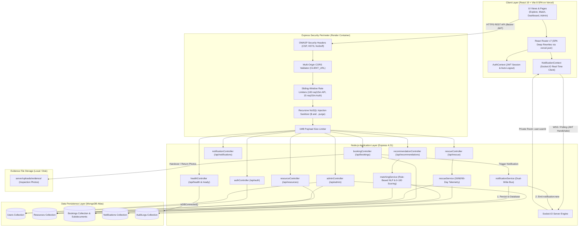
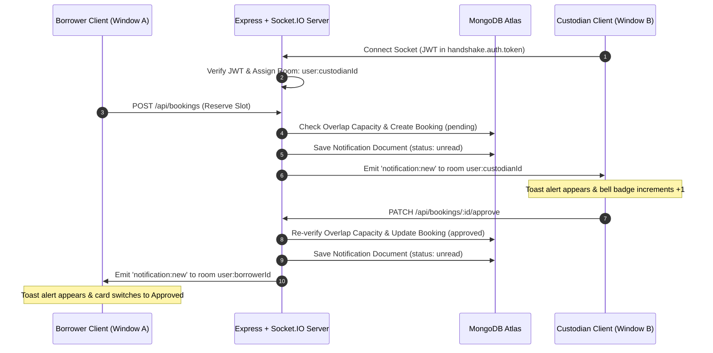
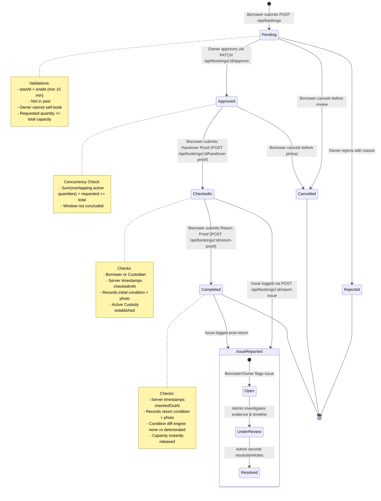

# Technical Architecture Documentation
## Project: Resource Sharing Platform — “Unlock Underused Equipment and Spaces”
### Event: CodeHack India 2026 | Track: Sustainable Campus Infrastructure & Smart Institutional Resource Sharing

---

## 1. System Topology Overview

The **Resource Sharing Platform** is architected as a decoupled, modern client-server web application engineered for high availability, zero-trust security isolation, real-time event dissemination, algorithmic resource intelligence, and verifiable physical custody.

### System Architecture Diagram

---

## 2. Frontend Client Architecture (`client/`)

- **Core Technologies:** React 19, Vite 8.3.5, Tailwind CSS 3.4, GSAP 3.15, Lucide React icons.
- **Routing & Deep-Linking:** React Router DOM v7. Configured with `client/vercel.json` rewrite rules (`/(.*)` -> `/index.html`) ensuring seamless browser reload on deep routes (`/match`, `/resources/:id`, `/admin`, `/dashboard`).
- **State Management & Contexts:**
  - `AuthContext`: Centralized session manager storing Bearer JWT in `localStorage`, maintaining current user profile, auto-logging out upon 401 Unauthorized or 403 Forbidden account suspension.
  - `NotificationContext`: Real-time notification manager controlling `socket.io-client` lifecycle, unread counter badges, audio notification chimes, and REST background synchronization.
- **Route Protections:**
  - `ProtectedRoute`: Rejects unauthenticated visitors and redirects to `/login` with intended destination preserved.
  - `AdminRoute`: Restricts access strictly to users with `role === 'admin'`; renders a secure 403 Forbidden screen for non-admin accounts.
- **Offline Resilience:** If the backend database drops, `ExplorePage` automatically switches to `SAMPLE_RESOURCES` with an amber warning banner.

---

## 3. Backend API Architecture (`server/`)

- **Runtime & Framework:** Node.js v20+ with Express 4.21.2.
- **Zero-Dependency Native Security Perimeter (`securityMiddleware.js`):**
  - **OWASP Headers:** Native implementation removing `X-Powered-By` and applying `X-Content-Type-Options: nosniff`, `X-Frame-Options: SAMEORIGIN`, `Strict-Transport-Security`, and `Content-Security-Policy`.
  - **Sliding-Window Rate Limiting:**
    - `/api/*`: 100 requests per 15 minutes per IP.
    - `/api/auth/*`: 15 requests per 15 minutes per IP (brute-force defense).
  - **Recursive NoSQL Injection Purge:** Recursively sanitizes request bodies, query strings, and params to strip `$` and `.` operators.
  - **ObjectId Format Validator:** Enforces valid 24-character hexadecimal regex on route parameters.
- **Error Handling & Scrubbing (`errorMiddleware.js`):**
  - Suppresses stack traces in production (`NODE_ENV === 'production'`).
  - Automatically scrubs sensitive MongoDB connection URIs (`[REDACTED_DATABASE_URI]`) in logs and response payloads.
- **Cloud Readiness Probes (`healthController.js`):**
  - `GET /api/health`: Process liveness probe reporting Node.js uptime.
  - `GET /api/health/ready`: Database readiness probe returning `200 OK` when MongoDB `readyState === 1` and `503 Service Unavailable` when offline.

---

## 4. Algorithmic Intelligence & Core Differentiators

### 4.1 Smart Resource Rescue Engine (`rescueService.js` — Part 11)
- **Mathematical Formula:**
  $$\text{Utilization Rate} = \left(\frac{\text{Total Confirmed Booked Hours}}{\text{Declared Available Operating Hours}}\right) \times 100$$
- **Classification Engine:**
  - `well_utilized` ($\ge 50\%$)
  - `moderately_utilized` ($20\% \text{ to } 49\%$)
  - `underused` ($< 20\%$)
- **Actionable Salvage Recommendations:** Evaluates underutilized listings to produce contextual recommendations: suggesting cross-departmental sharing, extended evening reservation windows, and automatic promotion in search results.
- **Dual Surface Exposure:** Custodians view personal utilization badges on `/dashboard`; administrators view macro campus metrics on `/admin`.

---

### 4.2 Proof-Based Handover & Return Verification (`bookingController.js` — Part 12)
- **Two-Point Evidence Protocol:**
  - **Check-In (Pickup):** Mandatory condition rating (`excellent`, `good`, `fair`, `damaged`), condition notes, and photo evidence upload. Server generates certified timestamp.
  - **Check-Out (Return):** Mandatory return condition rating, return notes, and return photo upload.
- **Automated Degradation Diff:** Compares pickup vs return condition states:
  - `none`: Conditions match or show negligible wear.
  - `improved`: Equipment was cleaned or repaired during loan.
  - `deteriorated`: Physical degradation detected.
- **Non-Punitive Wear-and-Tear:** Explicitly separates normal academic wear from actionable physical damage.
- **Chronological Visual Timeline:** Assembles a 6-milestone timeline (`booking_requested`, `booking_approved`, `handover_proof_submitted`, `checked_in`, `return_proof_submitted`, `checked_out`).
- **Lightbox Inspector:** Modal image viewer allowing administrators and custodians to inspect high-resolution photo evidence, timestamps, and actor roles.

---

### 4.3 Need-First Smart Resource Matching (`matchingService.js` — Part 13)
- **Rule-Based NLP Parser:** Client and server-side parser tokenizes queries, extracts target categories, detects user intent (`recording`, `testing`, `computing`, `collaboration`), and identifies campus locations.
- **Deterministic 0–100 Scoring Model:**
  - Category Match: +35 points
  - Activity Intent Overlap: Up to +25 points
  - Campus Proximity: +15 points
  - Availability & Capacity: +15 points
  - Smart Resource Rescue Boost: +10 points (promotes underused assets to balance campus load)
- **Live Boundary Capacity Check:** Evaluates overlapping bookings in the requested time window; fully occupied resources are excluded from direct matches and suggested under Alternative Recommendations with honest explanations.

---

## 5. Real-Time Notification Architecture (`socket/` & `notificationService.js`)

---

## 6. Booking Lifecycle & Capacity State Machine

---

## 7. Administrative Governance & Audit Architecture

- **Role-Based Guards:** `protect` validates user token and account status (`active`); `requireAdmin` validates `user.role === 'admin'`.
- **Immutable Audit Trail (`AuditLog` Collection):** Append-only collection recording:
  - `admin`: Reference to acting administrator.
  - `action`: Strict enum (`USER_ROLE_UPDATED`, `USER_STATUS_UPDATED`, `RESOURCE_MODERATED`, `ISSUE_STATUS_UPDATED`, `ADMIN_INITIALIZED`).
  - `targetId`: Target document ObjectId.
  - `targetModel`: Collection name (`User`, `Resource`, `Booking`).
  - `details`: Human-readable summary.
  - `metadata`: Snapshot of before and after states.
- **Defensive Safeguards:**
  - Self-demotion blocked with HTTP 400.
  - Demoting the last active administrator blocked with HTTP 400.
  - Admin self-suspension blocked with HTTP 400.

---

## 8. Deployment Boundaries & Cloud Configuration

| Component | Target Host | Manifest File | Configuration Highlights |
|---|---|---|---|
| **Frontend SPA** | **Vercel** | [`client/vercel.json`](file:///c:/Users/Asus/Desktop/Hackathons/Resourcce%20sharing%20platform/client/vercel.json) | Edge static CDN; rewrites all paths `/(.*)` to `/index.html`; edge security headers. |
| **Backend API** | **Render** | [`render.yaml`](file:///c:/Users/Asus/Desktop/Hackathons/Resourcce%20sharing%20platform/render.yaml) | Node.js web service; health check path at `/api/health/ready`; dynamic `$PORT`; auto-generated `JWT_SECRET`. |
| **Database** | **MongoDB Atlas** | Managed Cloud DB | Compound interval indexes (`resource`, `status`, `startAt`, `endAt`) for sub-10ms collision checks. |
| **DNS Strategy** | Dual-Mode | `server/src/config/db.js` | Uses custom DNS (`8.8.8.8, 1.1.1.1`) on Windows to resolve Node.js c-ares SRV lookup constraints, while preserving native container host DNS on Linux. |
